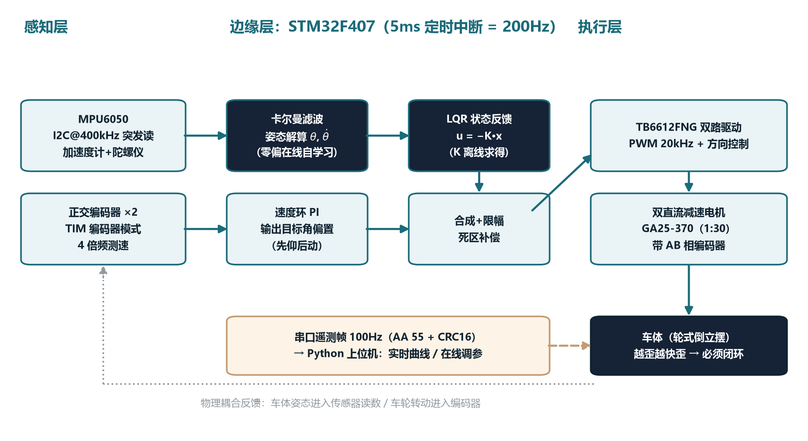
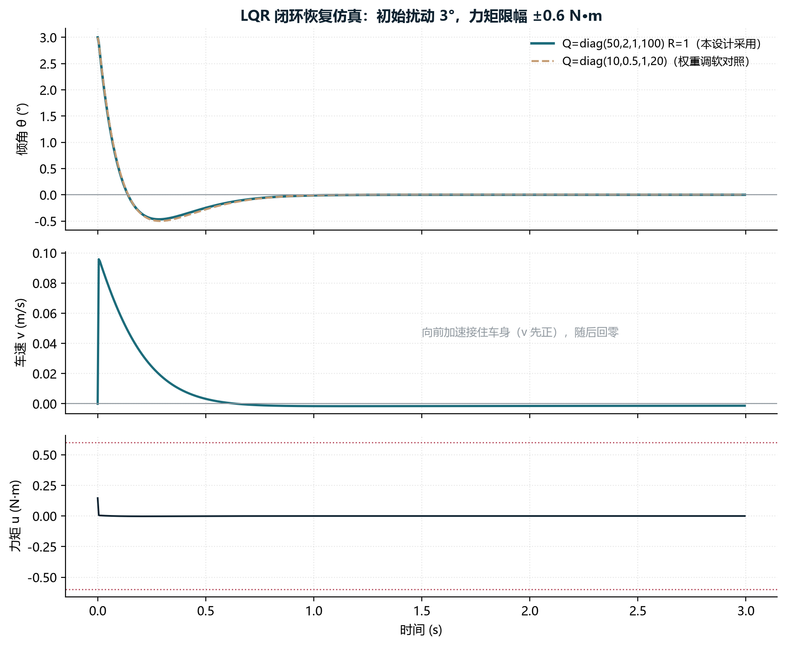

# STM32 双轮自平衡机器人（LQR + 卡尔曼滤波 + 强化学习）

基于 STM32F407 的两轮自平衡机器人完整工程：**卡尔曼滤波姿态融合 → 轮式倒立摆建模 → LQR 最优控制 → 速度闭环**，并附**强化学习（PPO）控制扩展**，可做 LQR vs RL 对照实验。



## 为什么不是又一个 PID 平衡车

| 维度 | 常见做法 | 本仓库 |
|---|---|---|
| 姿态获取 | DMP 黑盒 / 互补滤波系数拍脑袋 | 寄存器级驱动 + 二维卡尔曼（K=P⁻/(P⁻+R) 从最小方差推导），零偏在线自学习 |
| 建模 | 不建模 | 牛顿-欧拉四状态模型，参数摆线法/两工况法实测 |
| 控制器 | 直立环 PD + 速度环 PI 试凑 | LQR（Riccati 完整推导，离线求解），附鲁棒裕度保证 |
| 速度环 | 速度误差叠 PWM | "先仰后动"：速度 PI 输出目标角偏置，与物理机理自洽 |
| 扩展 | — | PPO 强化学习策略同签名替换 LQR，一键对照 |

核心数字：开环不稳定极点 ±15.7 rad/s → 1° 倒到 10° 仅 191ms → 决定 5ms（200Hz）控制周期。

## 仓库结构

```
├─ docs/
│  ├─ 制作指南.md                     ★ 零经验跟着做：购物清单/接线表/逐击配置/标定流程/故障排查
│  └─ 双轮自平衡机器人-毕业设计完整方案与答辩手册.docx   ★ 全部理论推导 + 40 问答辩手册（62页）
├─ code/
│  ├─ stm32/        固件全套（16 个文件，HAL，CubeIDE 直接可用）
│  ├─ design/       LQR 设计脚本(MATLAB/Octave) + 闭环仿真(Python)
│  ├─ host/         Python 上位机：实时曲线 + 在线调参 + 对抗性帧解析
│  └─ rl/           强化学习扩展：非线性环境 / PPO / ONNX 导出 / STM32 C 推理
└─ figures/         架构图、仿真曲线、时序预算图
```

## 快速开始

| 你想 | 去哪 |
|---|---|
| 从零把车做出来 | 读 [`docs/制作指南.md`](docs/制作指南.md)，购物清单在第 0 章 |
| 只想看理论推导 | [`docs/双轮自平衡机器人-毕业设计完整方案与答辩手册.docx`](docs/双轮自平衡机器人-毕业设计完整方案与答辩手册.docx) 第 2/4 章 |
| 改了机械参数重算 K | `code/design/design_lqr.m`（Octave/MATLAB） |
| 看实时曲线、在线调参 | `python code/host/gui.py COM5` |
| 跑/训强化学习策略 | [`code/rl/README.md`](code/rl/README.md)（含 Sim-to-Real Checklist） |

## 系统一览

- **硬件**：STM32F407VET6 + MPU6050(I2C@400kHz) + TB6612FNG + GA25-370 编码器电机×2 + 2S 锂电
- **实时链路**：5ms 定时中断（jitter<1%）完成 I2C 突发读 → 卡尔曼 → 编码器测速 → LQR+速度PI → 死区补偿 → 20kHz PWM；故障安全（I2C 失败断力矩、启动 gating、独立看门狗）
- **遥测**：921600bps，AA 55 + CRC16 帧，100Hz；上位机 PyQt5 + pyqtgraph
- **RL 扩展**：PPO 3→64→64→1 策略，17.5KB Flash，板上推理 <0.1ms

## 关键结果（实车 + 仿真）

| 指标 | 目标 |
|---|---|
| 静态平衡波动 | ≤ ±1.0° |
| 侧推 10° 摆角恢复 | ≤ 2s |
| 速度阶跃稳态误差 | ≤ 0.02 m/s |
| 上电自站立成功率 | ≥ 90% |

仿真曲线（由 `code/design/sim_lqr.py` 复现）：



## 环节对应

- 理论推导（卡尔曼五公式、变分法→Riccati、动力学消元）：手册第 2、4 章
- 逐项 CubeMX 配置与接线表：制作指南第 2、3 章
- 标定七步法（符号自检/零偏/死区/中值/直立环/速度环/滤波）：制作指南第 5 章
- 答辩准备：手册第 11 章 40 问

## License / 声明

MIT。用于毕业设计时请理解每一行（答辩会问），别直接交。
